# Лабораторная работа №4.

**Выполнила:** Палкина Агата

**Группа:** ЛА-3

**Вариант:** 8

---

## Задание 1. List (Задача 8)
**Текст задачи:** Вставляет в список L за первым вхождением элемента E все элементы списка L, если E входит в L.

### Алгоритм решения
Выполнение задачи (метод `Task01_InsertList`)
1. В метод передается список `list` и искомый элемент `e`.
2. Проверяется, что список не равен `null`. Если равен — выбрасывается исключение `ArgumentNullException`.
3. С помощью метода `IndexOf(e)` ищется индекс первого вхождения элемента `e`.
4. Если метод вернул `-1` (элемент не найден), список возвращается без изменений.
5. Если элемент найден, создается независимая копия исходного списка (`new List<int>(list)`). Это необходимо, чтобы при вставке элементы не начали бесконечно дублироваться.
6. С помощью метода `InsertRange(index + 1, copy)` копия вставляется в исходный список сразу после найденного элемента.
7. Метод возвращает измененный список.

### Тестирование
**Корректный ввод (элемент есть в списке):**
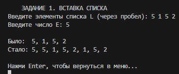

**Корректный ввод (элемента нет в списке — список не меняется):**
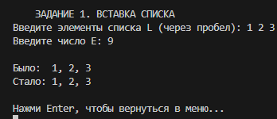

**Некорректный ввод (буквы вместо цифр):**
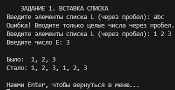

---

## Задание 2. LinkedList (Задача 8)
**Текст задачи:** Добавить в начало и конец списка L новый элемент E.

### Алгоритм решения
Выполнение задачи (метод `Task02_AddToEnds`)
1. В метод передается двусвязный список `list` и элемент `e`.
2. Проверяется список на `null`.
3. С помощью метода `AddFirst(e)` элемент добавляется в самое начало списка.
4. С помощью метода `AddLast(e)` элемент добавляется в самый конец списка.
5. Метод возвращает измененный список.

### Тестирование
**Корректный ввод:**
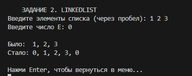

**Некорректный ввод (пустая строка):**
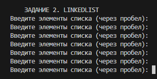

---

## Задание 3. HashSet (Задача 8)
**Текст задачи:** Есть перечень названий книг. Определить для каждой книги, какие из них прочли все из n читателей, какие — некоторые из читателей, и какие — никто из читателей.

### Алгоритм решения
Выполнение задачи (метод `Task03_Books`)
1. Метод принимает множество всех книг `allBooks` и список множеств книг каждого читателя `readers`.
2. Выполняется проверка на `null` и пустоту. Если данные некорректны, выбрасывается исключение.
3. Создается множество `allRead` (книги, прочитанные всеми). Оно инициализируется книгами первого читателя. Затем в цикле для остальных читателей применяется метод `IntersectWith` (пересечение множеств).
4. Создается множество `someRead` (книги, прочитанные хотя бы одним). В цикле по всем читателям применяется метод `UnionWith` (объединение).
5. Создается множество `nobodyRead` (книги, которые не прочитал никто). Оно инициализируется всеми книгами, а затем из него вычитаются книги, прочитанные кем-либо (`ExceptWith`).
6. Результаты выводятся на экран.

### Тестирование
**Корректный запуск (все данные заданы в коде):**
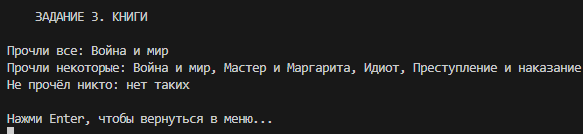

**Некорректный запуск (пустой перечень книг):**
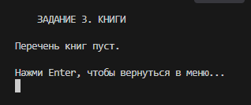

---

## Задание 4. HashSet (Задача 8)
**Текст задачи:** Файл содержит текст на русском языке. Напечатать те символы, которых нет в первом слове, но они присутствуют в каждом из других.

### Алгоритм решения
Выполнение задачи (метод `Task04_TextFile`)
1. Метод проверяет существование файла по указанному пути. Если файла нет — выводится ошибка.
2. Текст считывается из файла и разбивается на массив слов. Разделителями служат пробелы, переносы строк, точки и запятые.
3. Проверяется, что в файле есть хотя бы два слова.
4. Создается множество символов `firstWordChars` из первого слова. Эти символы в итоге должны быть исключены из ответа.
5. Создается множество `commonChars` из второго слова. 
6. В цикле (начиная с третьего слова) для `commonChars` применяется метод `IntersectWith`. После цикла в множестве остаются только символы, которые есть во всех словах, начиная со второго.
7. Из полученного множества вычитаются символы первого слова (`ExceptWith(firstWordChars)`).
8. Результат выводится на экран.

### Тестирование
**Корректный запуск (файл с текстом «зима роза корзина гроза»):**
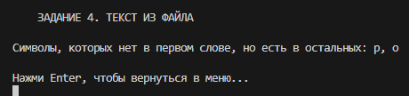

**Корректный запуск (нет общих символов, вывод «нет таких»):**
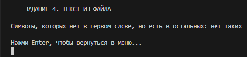

**Некорректный запуск (файл не найден):**
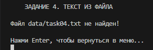

---

## Задание 5. Dictionary (Задача 8)
**Текст задачи:** Школьная олимпиада. Отбираются 25% лучших. Если у последнего в 25% такой же балл, как у следующих, все они призёры только тогда, когда их баллы > 35; иначе не призёры. Найти минимальный балл призёра и количество призёров в каждой параллели.

### Алгоритм решения
Выполнение задачи (метод `Task05_Olympiad`)
1. Файл считывается построчно. Проверяется корректность первой строки (количества участников).
2. В цикле данные парсятся. Создается список кортежей `participants` (Класс, Балл). Некорректные данные (класс не от 7 до 11, баллы не от 0 до 70) игнорируются (защита от некорректных данных).
3. Список сортируется по убыванию баллов с помощью `OrderByDescending`.
4. Вычисляется количество призеров по правилу 25% (`count25`). Находится граничный балл `threshold` (балл участника на позиции `count25 - 1`).
5. В цикле по всем участникам определяется, является ли он призером:
   - Если его балл `>` `threshold` — он призер.
   - Если его балл `==` `threshold`, проверяется правило: `балл > 35`. Если да — призер.
6. Для призеров подсчитывается количество в каждой параллели (классы 7-11) и запоминается минимальный балл призера.
7. Результаты выводятся на экран.

### Тестирование
**Корректный запуск (10 человек, есть ничья на границе 25%):**
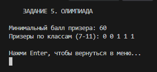

**Корректный запуск (все баллы ниже 35, призеров нет):**
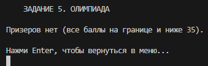

**Некорректный ввод (буква вместо количества участников в файле):**
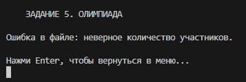

---

## Задание 6. Перегрузка операций
**Текст задачи:** Класс Money (поля uint rubles, byte kopeks). Метод: вычитание переменной типа Money (учесть, что сумма не может быть < 0). Результат — Money.

### Алгоритм решения
Описание класса `Money`
1. Приватные поля `_rubles` (uint) и `_kopeks` (byte). Использование `uint` защищает от отрицательных рублей, а `byte` — от копеек > 255.
2. Свойства `Rubles` и `Kopeks`. В сеттере свойства `Kopeks` стоит проверка: если значение > 99, выбрасывается исключение `ArgumentException`.
3. Конструктор принимает рубли и копейки и вызывает свойства.
4. Метод `Subtract(Money other)`:
   - Проверяет, что `other != null`.
   - Переводит обе суммы в копейки (тип `long`, чтобы избежать переполнения).
   - Вычитает.
   - Если результат < 0, возвращает `new Money(0, 0)`.
   - Иначе делит результат на 100 (рубли) и берет остаток (копейки).

### Тестирование
**Корректный ввод:**
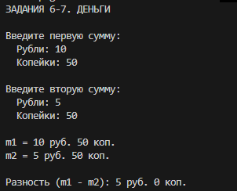

**Некорректный ввод (копеек больше 99):**
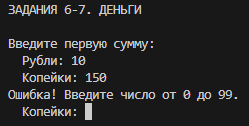

---

## Задание 7. Перегрузка операций (продолжение)
**Текст задачи:** Добавить к классу Money перегруженные операции: унарные ++ и --; приведения типов (неявное uint, явное double); бинарные (Money - uint, uint - Money, Money - Money).

### Алгоритм решения
1. **Унарные `++` и `--`:** переводят сумму в копейки, прибавляют/отнимают 1. При вычитании, если результат < 0, он приравнивается к 0. Возвращается новый объект `Money`.
2. **Приведение к `uint` (неявное):** возвращает только количество рублей (`_rubles`).
3. **Приведение к `double` (явное):** берет только копейки и делит их на 100.0 (чтобы получить дробную часть < 1).
4. **Бинарные операции `-`:**
   - `Money - uint`: переводит деньги в копейки, вычитает число, защищает от минуса.
   - `uint - Money`: вычитает из числа копейки денег, защищает от минуса.
   - `Money - Money`: вызывает ранее написанный метод `Subtract`.

### Тестирование
**Корректный ввод (проверка всех операций):**
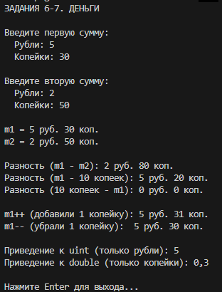

**Корректный ввод (защита от ухода в минус):**
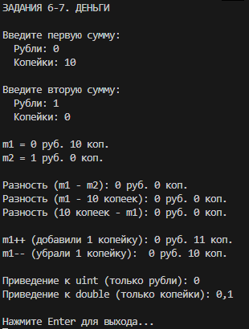
